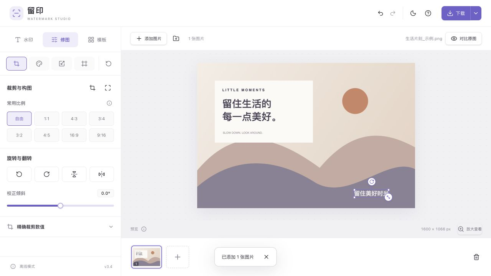

# 留印 · 本地图片工作台 v3.4

免费开源、纯浏览器运行的批量图片水印与编辑工具。添加文字、Logo 或手写签名，完成裁剪、调色和尺寸调整，单张下载或整批 ZIP 导出。图片在你的设备上处理，不上传服务器。

**[在线使用](https://watermark.huanxiong.site)** · [功能与使用说明](#已实现能力) · [本地运行](#使用) · [Pages 部署](#部署到-cloudflare-pages) · [GPL-3.0 许可](LICENSE)



- 无账号、无统计脚本、无运行时 CDN；HEIC / TIFF 解码器与 12 款艺术字体随应用打包。
- 多层水印、手写签名、整批默认与单张独立设置、可复用模板。
- React + Vite + shadcn/ui / Radix + Canvas；只需静态托管，无后端或 Pages Functions。
- 同时提供在线静态站点和构建后的单文件离线版本。

基于 [jzsn2018/offline-photo-watermark](https://github.com/jzsn2018/offline-photo-watermark) 的功能重实现与交互改版。保留浏览器本地处理和批量导出，增加多层水印、逐图编辑、图片处理和模板流程。参考 Watermark.ws 的照片编辑功能，自行实现本地 Canvas 渲染和工作台交互，不复制其代码、字体或付费素材。HEIC / HEIF 与 TIFF 解码器随应用打包，运行时不访问 CDN 或转换服务。

## 使用

**直接使用：** 双击 `dist/留印.html`，用现代浏览器打开。这个文件包含所有样式、程序和解码器，不需要安装 Node.js，也不需要网络。也可以打开项目根目录的 `index.html`，但需要保留 `styles.css`、`src/`、`vendor/` 与已构建的 `dist/ui.js`、`dist/ui.css`。本机浏览器工具无法直接验证 `file://`，已验证单文件通过本地 HTTP 加载后的断网使用，详见验证记录。

**本地开发与预览：** 安装 Node.js 22.12 或更新版本后，在项目目录执行：

```sh
npm ci
npm run build
npm start
```

浏览器访问 <http://127.0.0.1:4173>。服务仅监听本机；用 `Ctrl+C` 停止。可用 `PORT=4174 npm start` 修改端口。

```sh
npm ci        # 安装锁定版本的界面与解码依赖
npm run build  # 修改 JSX 后重新编译 UI，生成单文件离线版本
npm test       # 文档模型、格式、真实解码、ZIP 测试；ZIP 校验需要 Python 3
```

浏览器像素回归测试：启动服务后访问 `http://127.0.0.1:4173/tests/studio-browser.html`，应显示全部通过。

已有的 `vendor/` 与 `dist/` 可直接使用，启动本地服务不需要安装依赖。只有重新生成解码器和构建产物时需要 `npm ci`。

## 部署到 Cloudflare Pages

生产域名：[watermark.huanxiong.site](https://watermark.huanxiong.site)。GitHub 仓库：[Twinkling/watermark](https://github.com/Twinkling/watermark)。

在 Cloudflare Pages 连接此 GitHub 仓库，使用以下配置：

| 设置 | 值 |
| --- | --- |
| 生产分支 | `main` |
| 框架预设 | None |
| 根目录 | 仓库根目录 |
| 构建命令 | `npm run build:pages` |
| 构建输出目录 | `.pages-dist` |
| 环境变量 | `NODE_VERSION=24` |

构建时按 `package-lock.json` 安装依赖；无需 API Key、数据库或运行时环境变量。Pages 项目的「自定义域」添加 `watermark.huanxiong.site`，由 Cloudflare 创建指向该 Pages 项目的 CNAME 并签发 HTTPS 证书。当前 Pages 已设置 GitHub 来源与 `main` 生产分支，并启用自动部署开关。本次上线使用 Pages API 触发 Git 构建；后续推送的自动触发尚未验证，如未触发，请检查 Cloudflare Pages GitHub App 的仓库授权，并在 Pages 控制台重试部署。

本地检查部署产物：

```sh
npm ci
npm run build:pages
npm test
```

`.pages-dist/` 只包含运行资源、许可证和 404 页面，不发布测试、参考快照或开发目录。浏览器页面首次加载需要网络，加载完成后的图片处理无需上传或远程转换；需要可独立保存的离线版本请运行 `npm run build`，使用 `dist/留印.html`。

离线单文件包含完整字体，约 26 MiB，超过 Pages 的 [25 MiB 单文件限制](https://developers.cloudflare.com/pages/platform/limits/#file-size)。因此 Pages 使用独立 HTML / JS / CSS 静态资源，离线单文件保留在仓库中，不上传到 Pages。构建脚本会检查各部署文件的大小。

## 已实现能力

| 模块 | 功能 |
| --- | --- |
| 导入 | 多选、拖入、粘贴、文件夹；HEIC / HEIF、TIFF 等常见格式；错误隔离、去重、进度与取消 |
| 水印 | 最多 12 层文字、Logo 与手写笔迹；每行上移、下移、复制、隐藏、删除；兼容旧字体签名模板；平铺、九宫格、拖动、缩放、旋转、居中吸附 |
| 手写签名 | 鼠标、笔或手指书写；笔宽、颜色、逐笔撤销/重做与清空；透明背景、自动裁边；再次书写与模板复用 |
| 文字与 Logo | 多行、粗体/斜体/下划线、描边、阴影、背景；12 款内置商用艺术字体、系统字体和本地 TTF / OTF / WOFF / WOFF2；Logo 去白底与着色 |
| 图片编辑 | 自由框选和 7 种比例裁剪、90° 旋转、镜像、校直；按长边缩放、指定尺寸容纳/填满/拉伸、常用尺寸预设 |
| 外观 | 亮度、对比度、饱和度、色温、色调、自动亮度；7 种滤镜、10 种防护纹理、6 种边框及拍立得题字 |
| 批量与历史 | 整批默认 + 单张独立设置；恢复跟随整批；40 步撤销/重做；原图对比、100% 查看 |
| 模板 | 5 套预设；保存、搜索、置顶、重命名、复制、删除；导出/导入包含图层名称、Logo、字体与可编辑笔迹的 JSON 工作流 |
| 输出 | PNG / JPG / WebP、质量、文件名后缀；单张或整批 ZIP；单独导出透明水印素材；浏览器支持时调用系统分享 |
| 界面 | 水印 / 修图 / 模板三个入口；高级设置按需展开；独立下载设置；手机底部工具栏和可收起设置；深浅主题；统一 SVG 图标 |

## 操作流程

1. 添加图片，或点击“试用示例”。
2. 添加文字、图片水印，或点击“手写签名”书写，也可从模板预设起步。水印可在画布移动，右下角缩放，上方手柄旋转。
3. 默认修改整批。需要单张构图时，把“设置应用于”切为“仅当前”。缩略图带紫点的照片不受后续整批修改影响。
4. 在修图面板选择裁剪、调色、尺寸或装饰。点击比例进入裁剪，拖动框内移动、拖四角缩放、框外拖动重新选区；点击“应用裁剪”确认或“取消裁剪”放弃。切换工具、修图分类或图片会应用当前裁剪。未移动的比例预设按每张原图独立计算；手动调整后按相对区域应用。
5. 常用配置可手动保存为模板，或导出工作流文件到本地。
6. 导出当前图片或整批 ZIP；导出会使用每张图的有效设置。没有水印时也可导出图片编辑结果。

快捷键：⌘ / Ctrl Z 撤销，⌘ / Ctrl Shift Z 重做；选中水印后方向键微调，Shift 加速；旋转时 Shift 吸附 15°；Delete / Backspace 删除选中的水印。手机点击底部工具进入设置，点击“完成”返回预览。

列表中点击上下箭头改变叠放顺序，最上行显示在最前；顶层上移和底层下移自动禁用。裁剪时 Enter 应用、Escape 取消；选框获得焦点后可用方向键微调。指定宽高默认保持比例，解锁后可独立输入，最终尺寸实时显示。

## 输入格式

| 格式                                              | 处理方式                                                                       |
| ------------------------------------------------- | ------------------------------------------------------------------------------ |
| HEIC / HEIF，包括大写后缀                         | 优先浏览器解码，失败后用随包解码器在后台线程转换；图集取主图                   |
| JPG / JPEG / JFIF、PNG、WebP、AVIF、GIF、BMP、ICO | 浏览器原生解码，按实际文件内容识别；AVIF 需要新版浏览器                        |
| TIFF / TIF                                        | 本地后台线程解码，处理方向标签和透明度；多页文件取第一页并提示                 |
| SVG                                               | 支持独立 SVG、viewBox 与内部渐变；按画布尺寸转为位图，不加载外部资源或执行脚本 |
| GIF、APNG、动态 WebP / AVIF                       | 只导入静态首帧，不保留动画                                                     |

导入时显示当前文件与进度；某个文件失败不影响其他图片。所有输入统一导出为 PNG、JPG 或 WebP，不导出 HEIC、TIFF、SVG 或动画。特殊 TIFF（如 BigTIFF、浮点或部分 RAW 数据）、相机 RAW、PSD、PDF 不在当前支持范围。

## 处理边界

- 原图不上传、不持久保存；无账号、统计脚本、远程字体或 CDN。刷新后清空原图与编辑会话。只有手动保存的模板写入当前浏览器 localStorage，包含相关 Logo、字体、签名笔迹和配置；可在模板面板删除。导出的模板文件也包含这些素材，但不包含原图。
- 默认保留原始像素尺寸；裁剪、缩放和边框会改变输出尺寸，预览底部实时显示。PNG 和 WebP 支持透明背景，JPG 将透明区域填为白色。
- 导出重新编码像素，不主动复制源图的 EXIF/GPS 元数据；不承诺保留原图色彩配置文件或打印 DPI。
- 单批最多 40 张、单文件 50 MB、单图 32 百万像素、单边 16,384 像素、总图像 160 百万像素。ZIP 结果超过 512 MB 会提示分批处理。
- 浏览器原生格式的具体编码兼容性取决于浏览器；HEIC / TIFF 的非常规编码也可能失败并明确提示。后台解码最多等待 60 秒，大图性能和可用内存受设备限制。
- Logo 单文件不超过 10 MB / 4 百万像素，字体不超过 2 MB；模板文件不超过 15 MB，本地模板总内容限制约 4 百万字符，素材较大时应改为导出模板文件。
- 水印与防护纹理均不能保证不可移除。当前不包含视频、PDF、相机 RAW、PSD 图层、动画导出、AI 抠图/修图、云盘与账号同步，也不编辑 EXIF / IPTC。手写签名保留实际笔迹，不进行文字识别，也不提供电子签约或身份认证。
- 系统分享取决于浏览器和系统支持；用户选择接收应用后由系统完成发送。此入口不用于默认导出。

## 项目结构

```text
index.html                 工作台结构
styles.css                 桌面与手机交互样式
src/core.js                原版兼容核心、CRC32 与 ZIP
src/studio.js              v2 文档模型、图层、图像编辑与统一渲染
src/main.jsx               React 启动入口
src/ui/                    业务组件、状态、预览、签名面板与导出调度
src/components/ui/         本地 shadcn/ui 源码、许可与来源校验记录
src/components.css         构建时生成 Tailwind 样式并映射现有主题
components.json            shadcn/ui 组件配置
src/signature.js           笔迹规范化、平滑绘制与透明裁边
vite.config.mjs            将界面编译为本地 IIFE
src/formats.js             文件头识别、尺寸限制、方向变换
src/decode.js              原生解码、后台线程调度与 SVG 处理
src/codec-worker.js        HEIC / TIFF 后台解码入口
vendor/                    随包解码器、艺术字体和依赖许可证
scripts/vendor.cjs         从锁定依赖重新生成本地解码器
scripts/build.cjs          Vite 编译、资源内联和单文件离线构建
scripts/build-pages.cjs    生成独立 Pages 静态产物并检查文件大小
.pages-dist/              Pages 构建输出（不提交 Git）
scripts/serve.cjs          仅监听本机的开发服务
tests/                     核心测试、合成测试图、导出像素校验
docs/PROJECT-LOGIC.md      原项目与复刻版本的完整逻辑
docs/VERIFICATION.md       本次验证记录与未验证范围
reference/original.html   上游原始页面快照，便于对照
dist/留印.html             可单独使用的离线应用
```

## 来源与许可

提交代码前，请按 [公开仓库隐私检查](docs/PRIVACY.md) 启用本地提交钩子与 GitHub 隐私邮箱。不要提交个人照片、真实签名、环境凭据、HAR 或控制台截图。

视觉参考：[Photoroom 工具页](https://www.photoroom.com/tools) 的留白与黑白层次，以及 [Adobe Express 图片编辑页](https://www.adobe.com/express/feature/image/editor) 的中性背景与紫色强调。仅借鉴视觉原则，不复制代码、品牌标识或图片素材。主色 `#7160CD` 用于按钮、选中与焦点；示例图由本地 Canvas 绘制。

React 管理表单与面板生命周期，shadcn/ui + Radix 处理基础组件、焦点与键盘行为，Lucide 统一图标，CSS 变量统一颜色、边框与主题。Canvas 渲染、HEIC / TIFF 解码继续复用现有实现；Vite 只在构建时运行，全部运行资源在本地。

上游提交：`e0ab13ee99642523666a10adae41dbdf7002451d`，原项目由 `jzsn2018` 在 `joyqi/sfz` 基础上修改。完整 GPL v3 许可保留在 `LICENSE`；本项目沿用 `GPL-3.0-only`。修改说明见 `NOTICE.md`。

内置字体共 12 款：中文为马善政毛笔、龙藏手写、站酷快乐体、志莽行书、刘建毛草、霞鹜文楷 TC；英文为 Dancing Script、Great Vibes、Caveat、Allura、Sacramento、Kalam。均采用 SIL OFL 1.1，弹窗内保留完整授权；新增 6 款字体的模板需要 v3.3 或更新版本。字体按中文 / 英文 / 全部筛选，完整字库随单文件包内嵌，离线文件约 26 MB。英文款不含中文字形，使用系统字体回退。

字体及解码依赖版本、许可证、源码和重新构建说明见 [THIRD-PARTY-NOTICES.md](THIRD-PARTY-NOTICES.md)。
