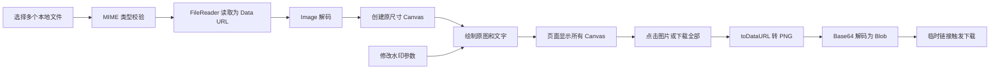
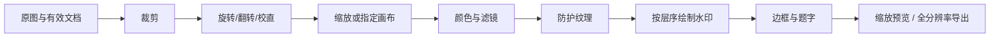

# 原项目逻辑与本地复刻设计

分析来源：[上游 index.html 的固定提交](https://github.com/jzsn2018/offline-photo-watermark/blob/e0ab13ee99642523666a10adae41dbdf7002451d/index.html)。本地原样快照见 `reference/original.html`；上游 README 见 `reference/README.upstream.md`。

## 一、原项目的实际功能与结构

项目只有一个运行文件 `index.html`，把 HTML、CSS、JavaScript 放在一起，无依赖、后端、数据库或构建步骤。`test/` 中是照片素材，不是自动化测试；`snapshot/` 是界面截图。

支持多图导入、文字平铺水印、颜色、不透明度、间距、字号、点击图片下载与下载全部。页面名称中的“打码”指的是添加水印，代码没有马赛克、局部遮挡或裁剪功能。

### 状态与入口

- `configInputSetting` 保存五个输入元素：`text`、`color`、`alpha`、`space`、`size`。渲染时直接读元素的 `value`。
- `allCanvas` 保存每张图的 `{ img, canvas, fileName }`。
- `image.change` 遍历选中的文件，只允许 MIME 为 PNG、JPEG、GIF；逐个启动异步读取。
- 每个参数的 `input` 事件遍历 `allCanvas`，同步重绘所有全分辨率 Canvas。
- 继续选图会追加到队列；没有去重、删除、清空、加载或失败状态。

### 文件解码与绘制

`readFile(file)` 创建 `FileReader`，用 `readAsDataURL` 将整个文件转成 Base64。读取完成后创建 `Image`，再在 `Image.onload` 中创建 Canvas，将宽高设为原图宽高。每个文件完成解码后才进入数组，因此图片顺序可能与选取顺序不同。读取或解码失败没有显式处理。

`redrawCanvas` 重新赋值画布宽高，清除像素和绘图状态，然后重新画原图。因此连续调整参数不会把新水印叠在旧水印上。

`makeStyle` 将 `#RRGGBB` 拆成三个十进制通道，和 `alpha` 拼成 RGBA。

`drawText` 的计算流程：

1. 字号 `fontSize = size × max(15, min(width, height) / 25)`。
2. 坐标系绕左上角固定旋转 45°。代码有角度 TODO，没有调整入口。
3. 使用粗体系统字体，用 `measureText` 测量水印文字宽度；一个“啊”的字宽作为横向间隔。
4. 用图片对角线 `sqrt(width² + height²)` 估算需要的覆盖范围。
5. 文字列数由文字宽度加间隔决定，行数由 `space × fontSize` 决定。
6. 嵌套循环调用 `fillText` 平铺文字。

### 下载

`downloadCanvasAsImage` 依次调用 `canvas.toDataURL('image/png')`、自制 Base64 解码函数、`URL.createObjectURL(blob)`，创建 `<a download>`，延时 10ms 后点击并移除链接。文件名是在完整原文件名后追加时间，因此可能得到 `photo.jpg_时间.png`。生成的 Object URL 没有被撤销。

`downloadAllPic` 的 `async` 没有实际等待逻辑，只是 `forEach` 触发多个单图下载；浏览器可能要求多文件下载授权或只允许部分下载。原项目没有导出状态、完整性检查或失败恢复提示。

## 二、本地实现与功能取舍（v3.4 界面 / v2 兼容文档）

本次按“照片本地处理”范围实现 Watermark.ws 可借鉴的交互和功能。自研文字/Logo/签名图层、10 种程序绘制纹理、7 种滤镜、6 种边框、模板和图片编辑；没有使用该网站代码或付费素材。视频、云端同步、PDF、AI 编辑不属于当前本地图片实现。

### 数据模型

`src/studio.js` 提供可序列化的文档 `{layers, edit}`：

- `layers` 最多 12 层。层包含稳定 ID、可选名称（最多 60 字符）、文字/签名/Logo 类型、显示状态、内容/素材 ID、字体、颜色、尺寸、角度、透明度、相对位置、平铺参数、描边/阴影/背景。Logo 还包含去白底与着色设置。
- `edit` 包含归一化裁剪区域、自动裁剪比例、90° 旋转/翻转/校直、颜色调整、滤镜、纹理、尺寸与边框。
- 所有输入经过 `normalize()` 约束；模板中的未知样式和越界值不能直接控制渲染器。
- Logo 与字体资源另存于内存 Map；文档只引用资源 ID。导入模板时重新分配 ID，避免覆盖已有素材。

`src/ui/store.js` 管理 `items`、当前图片、整批 `base`、应用范围、选中水印、输出配置、历史和模板。每张图的 `doc=null` 表示跟随整批，第一次单独修改时深复制默认文档；有效配置为 `item.doc || base`。拖动已有单独设置的图片时自动切到“仅当前”。

### v3 组件与手写签名

- `src/main.jsx` 创建 React 根节点；`App.jsx` 管理布局、导入入口和键盘/拖放事件，`Panels.jsx` 复用统一表单组件。水印、修图、模板为主导航，下载设置由右上按钮展开。单张工作时隐藏批量范围；精确参数、样式与历史按需展开，已有水印直接显示列表。
- `store.js` 通过订阅更新 React。连续输入只累积一次历史快照，切换、失焦或拖动结束时提交，不整块替换 DOM。
- `Preview.jsx` 用 ResizeObserver 与 requestAnimationFrame 调度共享 Canvas 渲染。选框、旋转/缩放手柄和裁剪框是独立覆盖层。导出按原尺寸重新渲染，不使用屏幕缩略图。
- `SignatureDialog.jsx` 使用 Pointer Events 接收鼠标、笔与触摸输入，固定 900×400 逻辑坐标，平滑绘制，独立记录逐笔历史。画板响应式缩放，坐标不依赖屏幕尺寸。
- `signature.js` 过滤非法坐标，限制 256 笔 / 20,000 点，计算带安全边距的笔迹范围，再以 3 倍比例输出透明 PNG。结果作为图片水印进入已有管线；素材元数据保留颜色、笔宽与笔迹，支持重新书写。
- 模板继续使用 version=2，签名素材增加可选 signature 元数据。没有此字段的旧模板仍按普通图片水印导入；新模板可恢复笔迹。原始照片不进入模板。
- Vite 将 React、shadcn/ui、Radix 和 Lucide 编译为 `dist/ui.js`，Tailwind 输出 `dist/ui.css`；离线构建内联 CSS 与 8 个脚本，不增加运行时网络请求。CSP 继续禁止 connect-src；依赖许可随发行物保留。

### 导入与资源生命周期

文件选择、文件夹、拖入、剪贴板共用 `importFiles`。文件头识别来自 `formats.js`，而不是只信任 MIME / 后缀。队列依次处理，逐项检查数量、大小、尺寸、总像素和重复；一个文件失败不阻塞后续文件。

`decode.js` 优先原生解码；HEIC / HEIF 失败时使用随包 libheif，TIFF 使用 UTIF，均在本地 Worker 处理。SVG 禁止外部资源与脚本。动图取静态帧，TIFF 多页取第一页并提示。Codec 源码入口、版本和许可见 `THIRD-PARTY-NOTICES.md`。

原图、位图和缩略图只在会话内。移除/清空会释放资源并清空涉及这些原图的撤销历史；页面退出释放图片，进入浏览器 BFCache 时保留资源以支持返回恢复。导入/导出及素材加载锁定编辑，避免异步完成后落到错误的图片。

### 统一预览与导出管线

`dimensions()` 计算裁剪、旋转、缩放后的照片尺寸，再计入边框。比例预设由 `cropFor()` 按每张源图长宽重新计算居中区域，横竖混排也保持目标比例；自由框选/数字裁剪使用归一化区域，跨图保持相对区域。长边模式不放大，指定画布支持完整容纳、裁切填满和拉伸。

`render()` 共用于预览与导出。预览只绘制当前图片，用 requestAnimationFrame 合并输入，并限制预览像素；100% 模式按原始输出尺寸绘制。图片处理不覆盖原图。颜色运算保留 alpha；JPG 最终白底，PNG / WebP 保留透明。

`geometry()` 为单处水印计算旋转包围盒、自动缩小和边缘限制。画布指针转换为预览像素坐标后更新相对位置或尺寸/角度；拖拽支持居中辅助线，Shift 旋转对齐 15°。比例坐标保证不同尺寸图片复用布局。圆角裁剪同时约束原图、纹理和水印。

导出冻结每张图的有效配置，顺序生成目标尺寸 Canvas，再通过 `toBlob()` 编码。单张直接下载，多张交给 `core.js` 的无压缩 ZIP 打包；同名文件自动编号。输出限制为单边 16,384 / 32 百万像素，ZIP 上限 512 MB。进度可取消，在当前文件完成后停止。

“只导出水印”仍使用最终画布尺寸与相同水印位置，但不绘制源图、纹理、边框和题字，输出透明 PNG。系统分享只在用户点击时尝试 `navigator.canShare` / `navigator.share`。

### 交互与可恢复性

`LayerList.jsx` 采用 42px 紧凑单行，将缩略图、自动名称和上移 / 下移 / 显示 / 复制 / 删除放在一起；动作显式绑定图层 ID。列表与渲染数组反序显示，最上行对应最后绘制的层，顶部上移与底部下移禁用。v3.2 移除列表拖拽、重命名和副标题，旧模板中的名称仍兼容。字体签名快捷入口已移除，旧类型继续兼容。

`ImagePanel.jsx` 提供裁剪、调色、尺寸、装饰四类控件。滤镜小图直接使用统一 Canvas 渲染器和当前原图；尺寸预设同步宽高与填充策略。宽高数值输入保留临时文本，并在开始编辑时冻结比例，避免逐位输入引起比例漂移。

裁剪以 `cropDraft` 保存临时选区，在原图覆盖层中预览；`geometry.mjs` 约束移动、四角缩放、固定比例与边界。取消丢弃草稿，应用才写入文档并形成一步历史。切换图片、工具或修图分类时自动应用；导出冻结文档之前先应用草稿。选用比例后未手动调整时保留自动比例模式，移动 / 缩放后转成归一化区域。手机进入裁剪时收起面板，画布上保留比例切换及应用 / 取消入口。

主导航为水印、修图、模板，下载设置从右上角打开。高级参数按需展开，批量范围在有多张图片或单张覆盖时显示。手机用底部工具栏和可收起的设置抽屉；进入框选裁剪时收起面板，在画布上方完成框选。大图预览旁保留原图切换、100% 与导出按钮，缩略图紫点标识单独设置。

撤销记录序列化文档与输出配置，不复制大图。连续输入/拖拽合并为一次记录，最多 40 步；支持重做。导入和移除原图清空历史，不承诺恢复已经释放的原图。主题切换仅作用于当前会话。

### 提示与界面文案

导入空状态直接展示支持的图片格式。水印添加与模板保存合并到顶部图标工具栏；修图分类、裁剪动作、旋转翻转、重置、比例锁定、文字格式与模板文件操作通过 `IconButton` 统一展示图标、`aria-label` 和悬浮提示，切换类操作保留 `aria-pressed`。裁剪操作与调色快捷操作放在对应分区标题旁，避免孤立按钮和额外操作行。主导航、参数名、比例与尺寸保持可见。基础组件采用本地 shadcn/ui New York 源码（`src/components/ui`），业务包装在 `src/ui/components.jsx`，Radix 处理焦点、键盘与浮层；Lucide 提供 SVG 图标。修图还原合并在顶部分类工具栏；模板保存、导入、导出合并在标题操作栏，无模板时隐藏搜索框。

操作说明通过 shadcn/ui Tooltip / Popover 展示，悬停或键盘聚焦显示，点击信息按钮可固定打开，Escape 和外部点击关闭。折叠标题和说明按钮为并列元素，不嵌套按钮或额外背景；默认、悬停、展开共用 24px 图标尺寸。Dialog 负责焦点限制与恢复，内部选择器或说明优先响应 Escape；全局编辑快捷键跳过浮层和滑块。滑块连续输入仍合并历史，支持撤销。Tailwind 只编译实际引入组件的样式，不引入全局 preflight；配色映射到现有 CSS 变量，Portal 内容显式继承深浅主题。组件源码来源、原始注册表校验和与本地适配见 `src/components/ui/sources.json`。

### 模板与隐私

模板 `{version:2,name,doc,assets,fonts,...}` 保存设置，相关 Logo 转内嵌 PNG，自定义字体转内嵌字体数据；不含原图。主动保存的模板写入 localStorage，支持置顶、搜索、重命名、复制和删除；JSON 导出/导入用于本地备份和迁移。

模板文件最大 15 MB、每份最多 12 个 Logo / 12 个字体，Logo 解码上限 4 百万像素，字体上限约 2 MB；浏览器存储的模板 JSON 限制 4 百万字符。达到容量限制时显示可操作的错误，建议导出模板文件。刷新清除原图与会话配置，保存过的模板仍在。

应用 CSP 禁止网络连接；脚本、样式和解码器随包，字体使用内置的 12 款 OFL 艺术字体、系统字体或用户导入的文件。导出重新编码像素，不复制源 EXIF / GPS，不承诺保留 ICC、DPI、HDR 或无损高位深。

### 内置艺术字体

`scripts/fonts.cjs` 校验本地字体 SHA-256 后生成 `vendor/fonts.js`，包含 12 款完整字库和授权全文。普通构建不下载字体。`FontPicker.jsx` 按中文 / 英文 / 全部分组，仅为当前分组加载 FontFace，并显示真实字形缩略预览；`fonts.js` 缓存加载 Promise 并在失败时允许重试。应用字体、加载含内置字体的模板都先等待字体就绪，再提交文档，避免首次导出使用系统回退字形。`studio.js` 白名单接受稳定的 `art_*` 字体 ID。

内置字体与上传字体分开管理：模板记录内置 ID，不重复嵌入大字库；导入模板时从应用自带字库注册，用户导入字体仍按原逻辑嵌入模板。使用新增字体的模板需要 v3.3 或更新版本。英文款不包含中文字形，使用系统中文回退。字体来源、授权、转换方式及校验信息见 `THIRD-PARTY-NOTICES.md` 和 `vendor/fonts/manifest.json`。

## 三、构建、验证与边界

`npm run build` 先用 Vite 编译 React 界面，再将 CSS、core/formats/codecs/fonts/decode/studio/signature/ui 八个脚本内联到 `dist/留印.html`。本地服务仅监听 `127.0.0.1:4173`。修改 JSX 后需要重新构建；已有发行物无需安装依赖即可运行。

`npm test` 覆盖原版核心、ZIP、实际 HEIC / TIFF 解码、文档归一化、批量裁剪和几何布局。`tests/studio-browser.html` 使用真实 Canvas 检查像素合成、颜色、透明度和变换；浏览器 UI 与真实下载结果还要单独验证，记录见 `VERIFICATION.md`。

当前不包括视频、PDF、RAW、PSD 图层、动画导出、云盘/账号同步、AI 抠图和 EXIF / IPTC 编辑。签名支持实际手写笔迹和字体文本，不进行手写识别或身份认证。具体浏览器和设备的原生格式、系统分享、字体与内存支持存在差异；没有经过实机矩阵测试的能力不视为跨浏览器保证。
